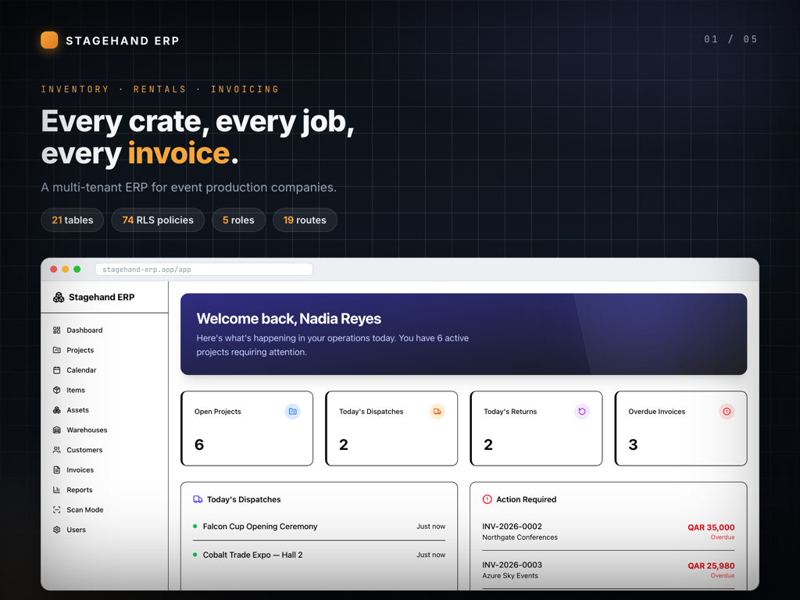
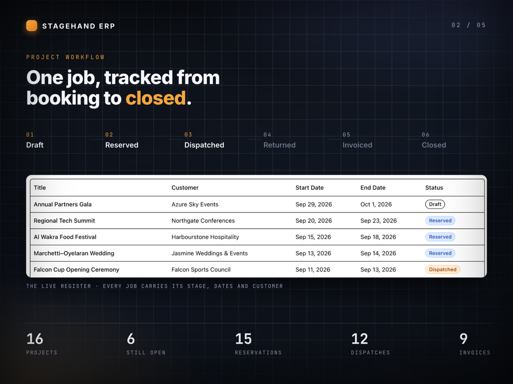
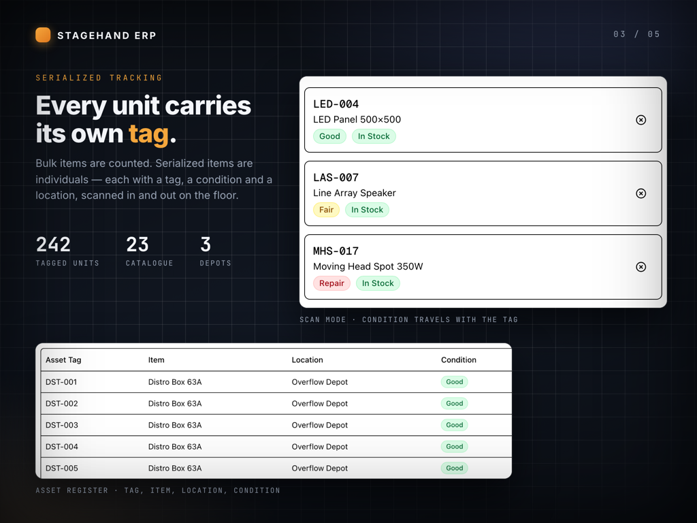
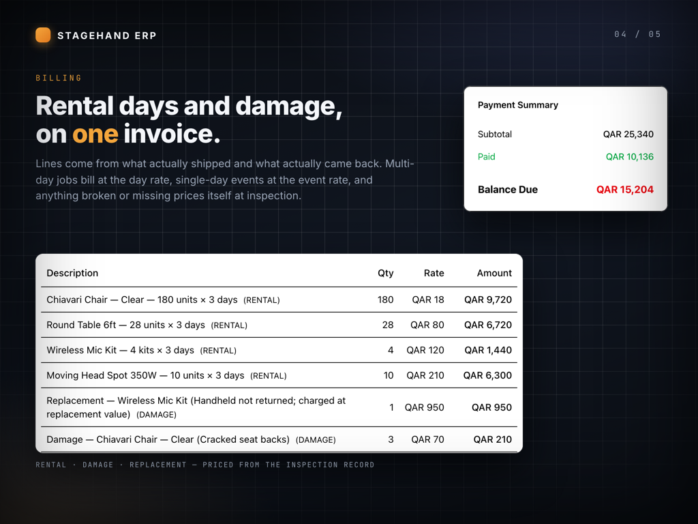
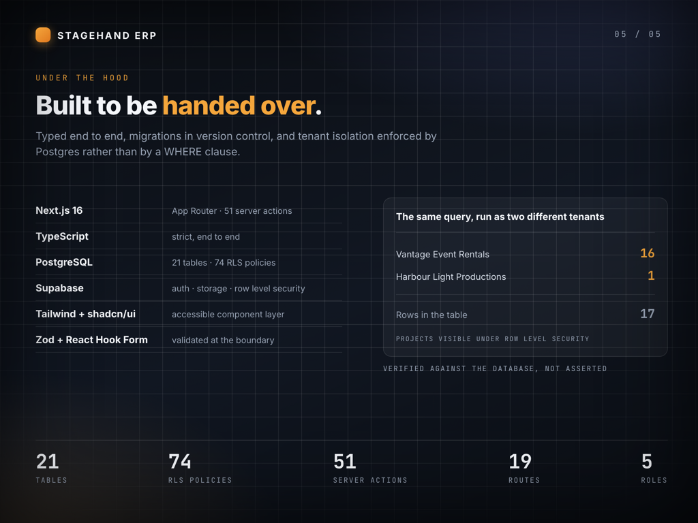
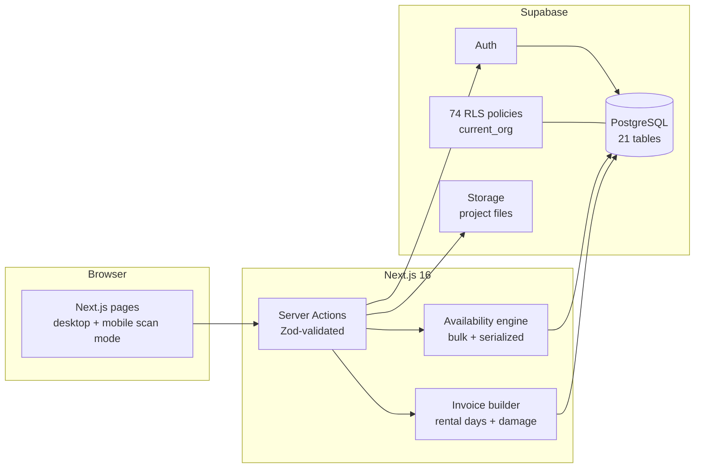
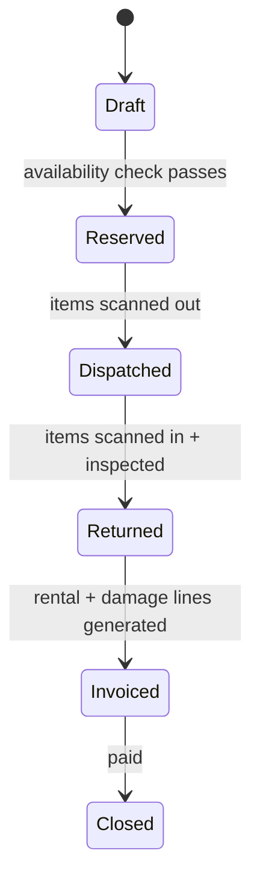

# Stagehand ERP: Event Rental Operations

**Case study.** A multi-tenant ERP for event-production companies, covering inventory, rentals, dispatch and returns, damage inspection and invoicing. It was built for an events company in Qatar.

> This repository is a write-up, not the source. The code belongs to the client and stays private.
> "Stagehand" is a stand-in name, and every screenshot uses **invented demo data** run on an isolated local stack.
> I'm happy to give a live walkthrough of the architecture and code in an interview.

| | |
|---|---|
| **Role** | Sole engineer: data model, security, backend, frontend |
| **Stack** | Next.js 16 (App Router, Server Actions) · TypeScript (strict) · Supabase (PostgreSQL, Auth, Storage, RLS) · Tailwind · shadcn/ui · Zod · React Hook Form |
| **Size** | 21 tables · 74 row-level-security policies · 51 server actions · 19 routes · 5 roles |

---

## The problem

An event-production company rents out chairs, staging, lighting and audio. Some of it is counted in bulk and some is individually tagged. The same stock goes out to overlapping jobs, comes back damaged or short, and has to be billed for exactly what happened. The system had to make double-booking impossible, follow every tagged unit, and turn returns and inspections straight into invoice lines.

## What I built

### One job, tracked from booking to close

Every project moves through a fixed lifecycle: **Draft → Reserved → Dispatched → Returned → Invoiced → Closed**. Reservations, dispatches, returns and inspections hang off the project, so its whole history is in one place.

### Availability engine: no double-booking
When a reservation is confirmed, the server checks every line against all overlapping reservations for that date range:
- **Bulk items** (e.g. 180 chairs) are checked by quantity.
- **Serialized items** (e.g. a specific moving-head light) are checked by individual asset, and the specific units are allocated.

If stock isn't free, the reservation fails with a clear message. You find out at booking time, not at the warehouse door.

### Serialized asset tracking and scan mode

Each tagged unit carries its own condition (Good / Fair / Repair) and location across multiple warehouses. A **mobile scan mode** lets warehouse staff scan items out on dispatch and back in on return.

### Invoices built from what actually happened

Invoice lines are generated from what was **actually dispatched and returned**. Multi-day jobs bill at the day rate. Anything recorded as damaged or missing during return inspection is priced automatically as a damage or replacement line. Payments, part-payments and overdue tracking are included.

### Tenant isolation enforced by Postgres

Isolation isn't a `WHERE org_id = ?` that a developer might forget. Every table has **row-level-security policies** keyed to a `current_org()` database function. I proved it rather than claimed it: the same query run as two different tenants returns 16 rows for one and 1 for the other, out of 17 in the table.

---

## Architecture

### Lifecycle

---

## Engineering notes

- **Listing a tenant's users, emails included, without bypassing RLS.** User emails live in `auth.users`, which the app role can't read. A plain view either gets refused or bypasses RLS entirely. I wrote a `SECURITY DEFINER` function that joins the two tables and scopes to `current_org()` internally, so it can only ever return the caller's own tenant.
- **I found and fixed real bugs while building the demo,** including a `.single()` call on an RLS-filtered query that silently emptied the users page, and a Tailwind v3→v4 colour-token mismatch that made every *Damaged / Missing / Void* badge invisible. Those are exactly the states an operator most needs to see.

---

*Built by [Fawas Koya](https://github.com/fawaskoya). Client details are anonymized, and all screenshots use synthetic data.*
